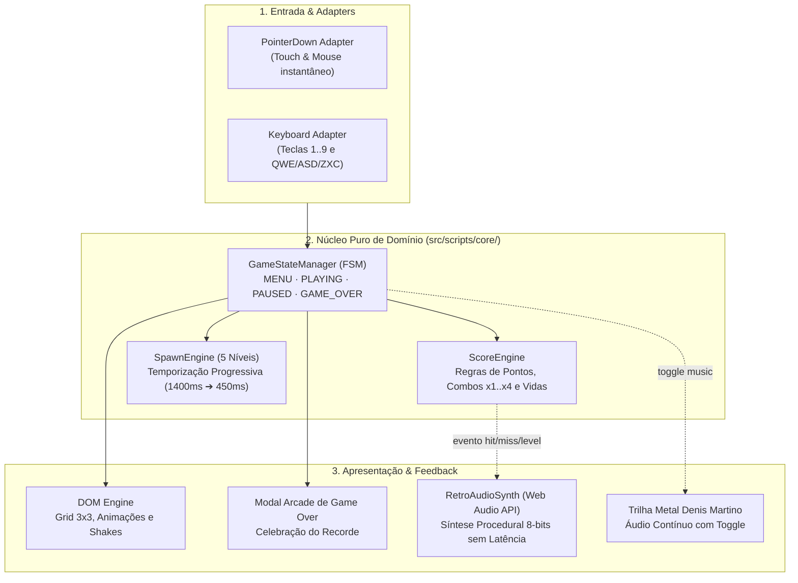
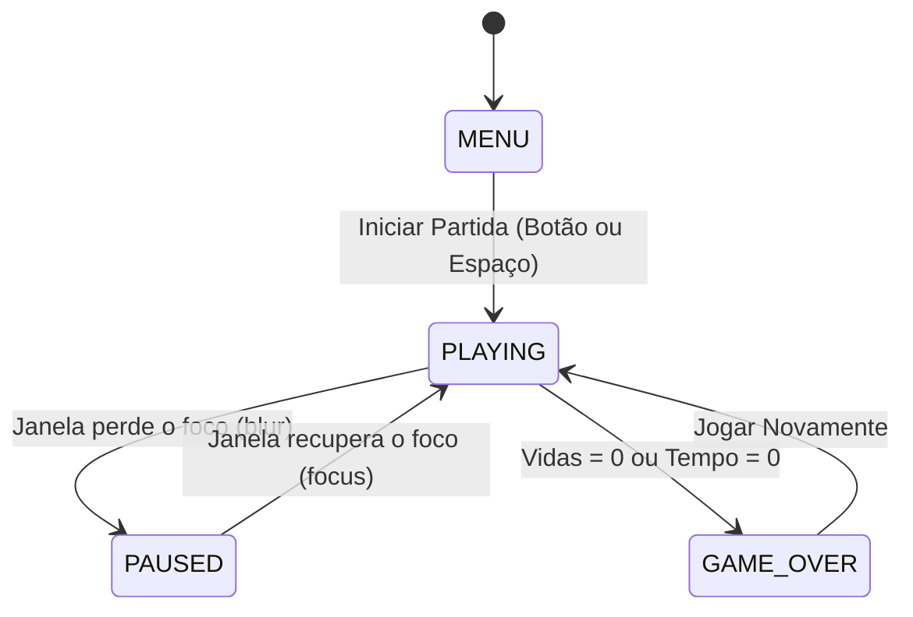

# ⚡ Dante Dash — Arcade Edition (v2.2)

> Jogo arcade de reflexo e agilidade desenvolvido em JavaScript ES6 nativo com arquitetura modular desacoplada (**FSM**, **ScoreEngine** puro, **Web Audio API Sintetizador Procedural**, **PWA Offline-First** e **suíte de testes nativa com `node --test`**), preservando a arte autoral desenhada pelo Dante aos 4 anos e a trilha de heavy metal do Denis Martino.

[](https://github.com/julianachavespalm/dante-dash/actions)
[](#suporte-pwa-e-offline-first)
[-blue.svg)](#arquitetura-e-estrutura)
[-success.svg)](#testes-automatizados)
[](https://julianachavespalm.github.io/dante-dash/)
[](LICENSE)

---

## 💛 A História por trás do Jogo

O **Dante Dash** é o projeto mais afetivo e especial deste ecossistema. Ele nasceu de uma colaboração familiar e artística:

* **Concepção Visual e Desenho do Herói:** Criado e desenhado originalmente por **Dante Chaves Martino** aos **4 anos de idade**. O herói e os inimigos animados preservam com fidelidade absoluta o traço autoral e a imaginação infantil do Dante.
* **Trilha Sonora Original:** Composta e gravada em guitarra heavy metal pelo professor e músico **Denis Martino Cota**.
* **Engenharia de Software e Game Architecture:** Arquitetura desacoplada, máquina de estados finitos (FSM), síntese Web Audio procedural, PWA e suíte de testes desenvolvidos por **Juliana Chaves Palm**.

---

## 🏛️ Arquitetura e Decisões de Engenharia

O jogo foi concebido sob uma **Clean Game Architecture** sem frameworks externos, onde as regras de negócio de pontuação e ciclo de vida são 100% isoladas da camada de apresentação:



### Máquina de Estados Finitos (FSM)



---

## 🕹️ Funcionalidades da Arcade Edition v2.2

1. **Sintetizador Web Audio API 8-Bits Procedural:** Efeitos sonoros gerados dinamicamente em tempo real (ondas quadradas e dente-de-serra via `OscillatorNode` + `GainNode`), eliminando 100% da latência de download e decode de áudio ao clicar no herói.
2. **Pré-carregamento e Decodificação de Sprites na GPU:** As animações e artes originais do Dante (`player.png`, `enemy-fighting.gif`, `enemy-dancing.gif`) são pré-carregadas via `Image.decode()`, eliminando qualquer atraso na renderização visual dos alvos.
3. **Progressão de Dificuldade em 5 Níveis (Warm-up Calmo para Criança):**
   - **Nível 1 (0 a 29 pts):** 1400ms — Começo tranquilo e acolhedor para aquecer reflexos.
   - **Nível 2 (30 a 79 pts):** 1100ms — Monstrinhos do caderno ganham vida.
   - **Nível 3 (80 a 149 pts):** 850ms — Solo de metal esquentando a arena.
   - **Nível 4 (150 a 229 pts):** 650ms — Super velocidade turbo ativada.
   - **Nível 5 (230+ pts):** 450ms — Modo lendário ninja.
4. **Narrativa e Lore Dinâmico:** Cada fase avança uma história temática no painel arcade sem necessidade de alterar as animações originais.
5. **Botões 8-Bits Encaixados no Console:** Design chanfrado em pixel art perfeitamente encaixado na barra de comando, com a paleta autêntica das canetinhas do Dante (Azul Royal `#1D4ED8` e Vermelho `#DC2626`).
6. **Layout Totalmente Responsivo e Sem Rolagem Horizontal:** Correção de overflow viewport desktop e mobile, mantendo o enquadramento arcade limpo.
7. **PWA e Offline-First:**
   - Com `manifest.json` e Service Worker (`sw.js`), instalável nativamente em Android, iOS e Desktop.

---

## 🧪 Testes Automatizados

Suíte de testes unitários determinísticos executados com o test runner nativo do Node.js (`node:test` e `node:assert/strict`):

```bash
# Executar a suíte de testes
npm test

# Executar com relatório de cobertura
npm run test:coverage
```

**Cenários testados (10 testes unitários — 100% de sucesso em ~150ms):**
- **ScoreEngine:** Inicialização de estado, progressão de multiplicador de combos (`x1` a `x4`), limite máximo, penalização de vidas e recorde histórico.
- **SpawnEngine:** Progressão em 5 fases (1400ms ➔ 450ms), detecção de Level Up, reset de estado e sorteio sem repetição consecutiva.
- **GameStateManager:** Validação do grafo de transições válidas, prevenção de saltos de estado proibidos e hooks de ciclo de vida.

---

## 🎮 Como Jogar

Acesse a versão ao vivo: **[https://julianachavespalm.github.io/dante-dash/](https://julianachavespalm.github.io/dante-dash/)**

| Dispositivo | Ação | Como Acertar |
| :--- | :--- | :--- |
| **📱 Smartphone / Tablet** | Toque na tela | Toque diretamente sobre o quadrado onde o herói surgir. |
| **💻 Computador (Mouse)** | Clique esquerdo | Clique sobre o quadrado ativo com o cursor do mouse. |
| **⌨️ Teclado (Desktop)** | Teclas numéricas | Pressione `1` a `9` (ou `Q/W/E`, `A/S/D`, `Z/X/C`) conforme o grid. |

---

## 🛠️ Estrutura de Pastas

```text
dante-dash/
├── .github/workflows/
│   └── ci.yml                  # Pipeline CI multi-versão do Node.js (18, 20, 22)
├── manifest.json               # Configuração PWA
├── sw.js                       # Service Worker com cache-first offline v2.2
├── index.html                  # Casca semântica, console docked 8-bit e footer oficial
├── package.json                # Configuração do pacote ES6 (v2.2.0)
├── src/
│   ├── audios/
│   │   └── trilha-metal...m4a  # Trilha sonora original em heavy metal (Denis Martino)
│   ├── img/
│   │   ├── player.png          # Arte autoral desenhada pelo Dante aos 4 anos
│   │   ├── enemy-fighting.gif  # Animação do herói no grid
│   │   ├── enemy-dancing.gif   # Animação comemorativa de novo recorde
│   │   └── wall.png            # Textura de tijolos da arena
│   ├── scripts/
│   │   ├── audio/
│   │   │   └── synth.js        # Sintetizador Web Audio API 8-bits procedural
│   │   ├── core/               # Domínio Puro (Zero DOM / 100% Testável)
│   │   │   ├── gameState.js    # FSM com transições de ciclo de vida
│   │   │   ├── scoreEngine.js  # Regras de pontuação, combos e vidas
│   │   │   └── spawnEngine.js  # 5 Níveis adaptativos e lore progressivo
│   │   └── engine.js           # Orquestração do DOM, inputs, áudio e Service Worker
│   └── styles/
│       ├── reset.css           # Normalização de estilos
│       └── main.css            # Tipografia retrô 8-bit, dock de botões e zero rolagem
└── tests/
    └── core.test.js            # Suíte nativa com node:test (10 testes)
```

---

## 💛 Créditos e Autoria

* **Desenvolvimento e Engenharia de Software:** [Juliana Chaves Palm](https://github.com/julianachavespalm)
* **Direção de Arte e Desenho do Personagem:** Dante Chaves Martino (aos 4 anos)
* **Trilha Sonora Original:** Denis Martino Cota

[](https://linkedin.com/in/julianachavespalm)
[](https://github.com/julianachavespalm)
