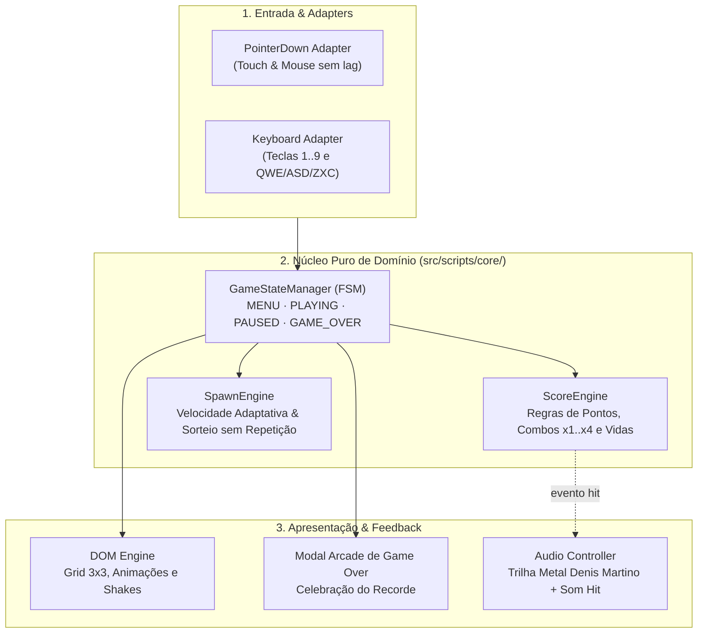
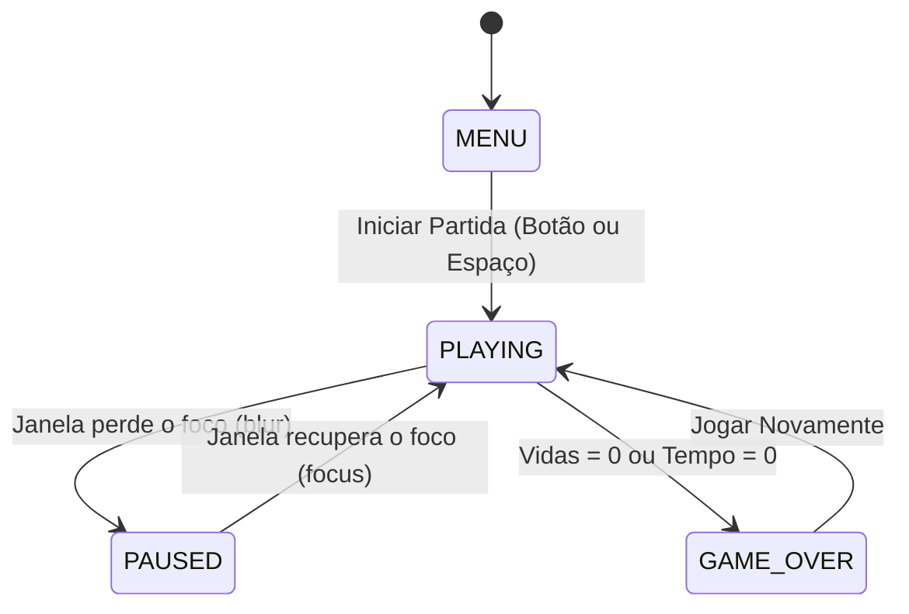

# ⚡ Dante Dash — Arcade Edition (v2.1)

> Jogo arcade de reflexo e agilidade desenvolvido em JavaScript ES6 nativo com arquitetura modular desacoplada (**FSM**, **ScoreEngine** puro, **PWA Offline-First** e **suíte de testes nativa com `node --test`**), preservando a arte autoral desenhada pelo Dante aos 4 anos e a trilha de heavy metal do Denis Martino.

[](https://github.com/julianachavespalm/dante-dash/actions)
[](#suporte-pwa-e-offline-first)
[-blue.svg)](#arquitetura-e-estrutura)
[-success.svg)](#testes-automatizados)
[](https://julianachavespalm.github.io/dante-dash/)
[](LICENSE)

---

## 💛 A História por trás do Jogo

O **Dante Dash** é o projeto mais afetivo e especial deste ecossistema. Ele nasceu de uma colaboração familiar e artística:

* **Concepção Visual e Desenho do Herói:** Criado e desenhado originalmente por **Dante Chaves Martino** aos **4 anos de idade**. O herói e os inimigos animados preservam com fidelidade absoluta o traço autoral e a imaginação infantil do Dante.
* **Trilha Sonora Original:** Composta e gravada em guitarra heavy metal pelo professor e músico **Denis Martino Cota**.
* **Engenharia de Software e Game Architecture:** Arquitetura desacoplada, máquina de estados finitos (FSM), PWA e suíte de testes desenvolvidos por **Juliana Chaves Palm**.

---

## 🏛️ Arquitetura e Decisões de Engenharia

O jogo foi refatorado para seguir uma **Clean Game Architecture** sem frameworks externos, onde as regras de negócio de pontuação e ciclo de vida são 100% isoladas da camada de apresentação:



### Máquina de Estados Finitos (FSM)



---

## 🕹️ Funcionalidades da Arcade Edition

1. **Velocidade Dinâmica Adaptativa:** O `SpawnEngine` acelera a frequência de aparição do herói/vilão conforme o placar aumenta, variando de 1000ms até 450ms.
2. **Sistema de Combos & Multiplicadores:** Acertos em sequência acumulam multiplicadores (`x2`, `x3`, `x4`!), maximizando a pontuação.
3. **Sistema de Vidas (3 Corações ❤️❤️❤️):** Erros de clique penalizam vidas. O jogo encerra se as 3 vidas acabarem ou se o cronômetro zerar.
4. **Pausa Automática Inteligente:** Se o jogador minimizar a janela ou receber uma notificação no celular, a FSM transiciona para `PAUSED` sem queimar o tempo de jogo.
5. **Multiplataforma Touch-First e Teclado:**
   - **No Smartphone:** Resposta tátil imediata via `pointerdown` (elimina o delay de 300ms do mobile).
   - **No Teclado do Desktop:** Mapeamento instantâneo das teclas numéricas `1` a `9` ou das teclas `Q, W, E / A, S, D / Z, X, C` correspondentes ao grid.
6. **Suporte PWA e Offline-First:**
   - Através de `manifest.json` e `sw.js` (Service Worker com cache inteligente), o jogo pode ser "instalado" no smartphone e jogado mesmo sem conexão com a internet.

---

## 🧪 Testes Automatizados

Suíte de testes unitários determinísticos executados com o test runner nativo do Node.js (`node:test` e `node:assert/strict`):

```bash
# Executar a suíte de testes
npm test

# Executar com relatório de cobertura
npm run test:coverage
```

**Cenários testados (9 testes unitários — 100% de sucesso em ~200ms):**
- **ScoreEngine:** Inicialização de estado, progressão de multiplicador de combos (`x1` a `x4`), limite máximo, penalização de vidas e salvamento de recorde histórico.
- **SpawnEngine:** Cálculo de aceleração em curva assintótica e sorteio pseudo-aleatório garantindo zero repetição consecutiva de casas.
- **GameStateManager:** Validação do grafo de transições válidas, prevenção de saltos de estado proibidos e hooks de ciclo de vida.

---

## 🎮 Como Jogar

Acesse a versão ao vivo: **[https://julianachavespalm.github.io/dante-dash/](https://julianachavespalm.github.io/dante-dash/)**

| Dispositivo | Ação | Como Acertar |
| :--- | :--- | :--- |
| **📱 Smartphone / Tablet** | Toque na tela | Toque diretamente sobre o quadrado onde o herói surgir. |
| **💻 Computador (Mouse)** | Clique esquerdo | Clique sobre o quadrado ativo com o cursor do mouse. |
| **⌨️ Teclado (Desktop)** | Teclas numéricas | Pressione `1` a `9` (ou `Q/W/E`, `A/S/D`, `Z/X/C`) conforme o grid. |

---

## 🛠️ Estrutura de Pastas

```text
dante-dash/
├── .github/workflows/
│   └── ci.yml                  # Esteira de CI multi-versão do Node.js (18, 20, 22)
├── manifest.json               # Configuração PWA para instalação no celular/desktop
├── sw.js                       # Service Worker com estratégia de Cache-First offline
├── index.html                  # Casca semântica, scoreboard arcade e modal de game over
├── package.json                # Configuração do pacote ES6 e scripts de teste
├── src/
│   ├── audios/
│   │   ├── hit.m4a             # Som de impacto
│   │   └── trilha-metal...m4a  # Trilha sonora original em heavy metal (Denis Martino)
│   ├── img/
│   │   ├── player.png          # Arte do herói desenhada pelo Dante aos 4 anos
│   │   ├── enemy-fighting.gif  # Animação do herói em ação no grid
│   │   ├── enemy-dancing.gif   # Animação do herói comemorando novo recorde
│   │   └── wall.png            # Textura de fundo da arena
│   ├── scripts/
│   │   ├── core/               # Domínio Puro (Zero DOM / 100% Testável)
│   │   │   ├── gameState.js    # FSM com transições de ciclo de vida
│   │   │   ├── scoreEngine.js  # Regras de pontuação, combos e vidas
│   │   │   └── spawnEngine.js  # Curva de velocidade adaptativa e sorteio
│   │   └── engine.js           # Orquestração do DOM, inputs, áudio e Service Worker
│   └── styles/
│       ├── reset.css           # Normalização de estilos
│       └── main.css            # Tipografia retrô 8-bit, grid responsivo e modal
└── tests/
    └── core.test.js            # Suíte nativa com node:test
```

---

## 💛 Créditos e Autoria

* **Direção de Arte do Personagem:** Dante Chaves Martino (aos 4 anos)
* **Trilha Sonora Original:** Denis Martino Cota
* **Desenvolvimento e Engenharia:** [Juliana Chaves Palm](https://github.com/julianachavespalm)

[](https://linkedin.com/in/julianachavespalm)
[](https://github.com/julianachavespalm)
